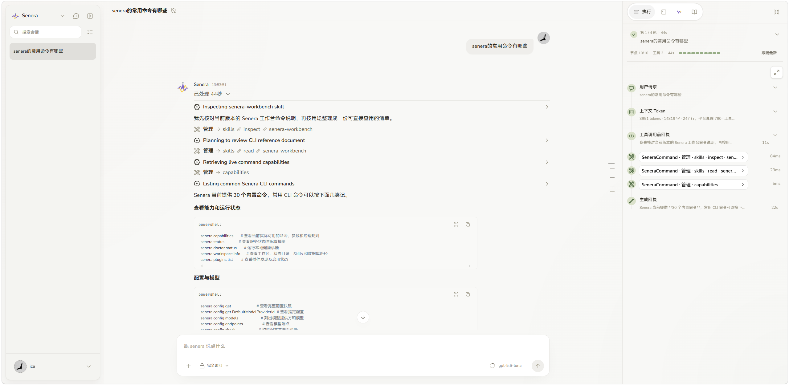
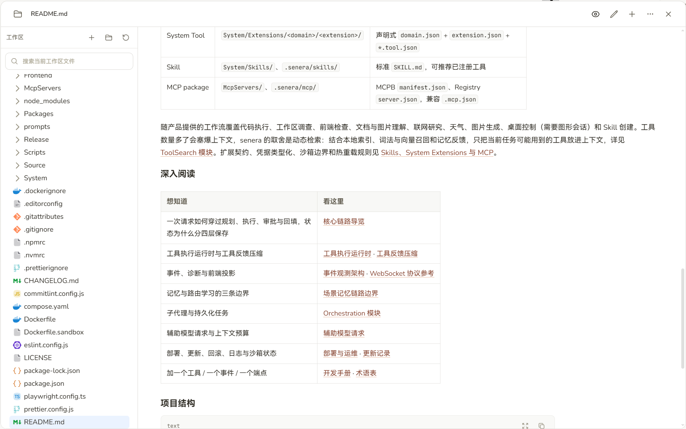
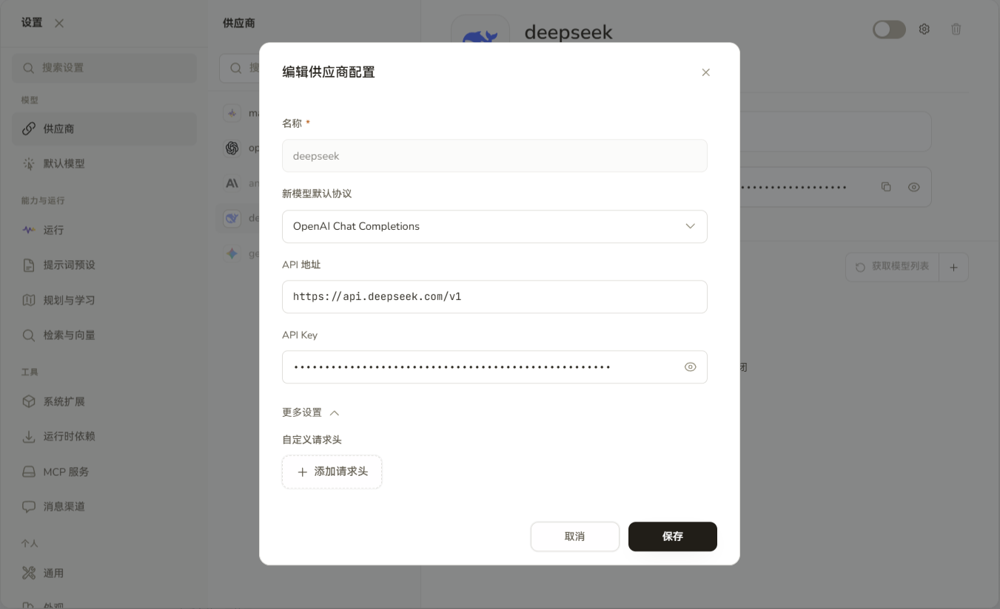

<p align="center">
  
</p>

<h1 align="center">senera</h1>

<p align="center">
  <strong>本机 Agent 运行时</strong><br />
  模型只出意图，授权、执行和留证都由宿主完成，不支持原生工具调用的模型也能把活干完。
</p>

<p align="center">
  <a href="https://github.com/yuanplussfive/senera/releases/latest"></a>
  <a href="https://github.com/yuanplussfive/senera/actions/workflows/verify.yml"></a>
  <a href="https://github.com/yuanplussfive/senera/releases/latest"></a>
  <a href="./docs/Operations.md"></a>
  
  
  
</p>

<p align="center">
  <strong>中文</strong> · <a href="./README.en.md">English</a>
</p>

<p align="center">
  
</p>

<p align="center">
  
  
</p>

## 设计动机

现有 Agent 工具普遍存在一处断层：对话表现稳定，执行表现不可控。一类实现把稳定性寄托在参数拼接上，一个未转义的引号就能让调用链中断，且中断后无法还原当时执行到哪个工具、哪一步失败；另一类把执行能力完全绑定在供应商的原生 Tool Calling 上，更换模型或端点时行为随之变化。

**senera 的处理方式是彻底分离意图生成与执行。**

模型生成意图，宿主运行时负责执行。会话树、多步工具循环与上下文压缩由 [Pi Coding Agent](https://github.com/earendil-works/pi) 承担；参数校验、权限策略、沙箱边界、证据打包与实时观测由 senera 实现。工作台右栏的执行树来自当前回合的实时事件，不是事后由日志重建的结果。

## 核心能力

### 1. 统一约束，不依赖模型的原生工具调用

不要求模型具备原生工具调用能力。每个模型可在设置中指定规划路径：

- **`native`**：模型与端点适配器均支持原生 Tool Calling 时直接用这条链路，步骤更少，延迟更低。
- **`baml`**：面向不支持原生调用，或需要结构化规划的模型，由 [BAML](https://github.com/BoundaryML/baml) 生成类型安全的动作计划。

两条路径仅在入口分流，参数校验、审批流程、执行合同与结果回填完全共用，运行期间不会切换。供应商差异只出现在适配层，更换模型不影响已有工作流。

### 2. 策略判定与显式审批

工具能否调用、路径能否读写，由编译为 WebAssembly 的 [Open Policy Agent (OPA)](https://github.com/open-policy-agent/opa) `.rego` 策略判定，结果为 `allow`、`ask` 或 `deny`：

- **`deny` 直接拦截**：判定为 `deny` 的调用不进入审批界面。
- **`ask` 只有四个选项**：**仅本次**、**本会话**、**拒绝**、**拒绝并停止**，不做推测性匹配。
- **执行目标由合同声明**：每个工具合同都显式声明执行目标与网络权限。要求沙箱容器执行的工具，在 Docker 未启动或沙箱不可用时直接报错终止，不会退回宿主机执行。

### 3. 证据完整，上下文不膨胀

长时间运行常见问题有两类：输出过长挤占上下文，或压缩之后丢失关键细节。

每次工具执行后，senera 把输入参数、原始输出、摘要、前端投影与文件变更打包成一个独立的 **Artifact** 落盘。结合 [@agent-context/sift](https://github.com/agents-sdk/sift) 与 `gpt-tokenizer`，写回模型的内容只包含精简摘要与 Artifact URI。上下文长度保持稳定，追查细节时沿 URI 就能取回当时的原始输出。

### 4. 检索与记忆全部本地完成

多数 Agent 框架需要分别配置 Embedding 与 Rerank 端点。senera 两类都不配，检索与记忆都在本机跑：

- **向量编码**：内置 [ternlight-mini-cn](https://github.com/soycaporal/ternlight) 句子编码器，随程序分发，在本机 CPU 上运行，向量计算不产生外部请求。
- **混合召回与路由学习**：由 [node-rs jieba](https://github.com/napi-rs/node-rs) 分词、[MiniSearch](https://github.com/lucaong/minisearch) 词法检索、[sqlite-vec](https://github.com/asg017/sqlite-vec) 向量索引与本地打分重排组成，再叠加历史路由反馈。工具数量较多时，每个回合仍只注入与当前任务相关的工具。
- **跨会话长期记忆**：基于 [MemOS SDK](https://github.com/Markgatcha/memos)，记忆的提取、存储与向量召回同样走本地链路，仅需一个对话模型即可启用全部能力。

### 5. 数据本地留存

配置、会话树、Artifact 证据、长期记忆、自定义 Skills 与运行日志统一存放在指定工作区的 `.senera/` 目录，不强制同步到云端。API Key 落盘前经 `AES-256-GCM` 加密。服务默认只监听本机回环地址 `127.0.0.1`。

## 功能范围

Web 端与 Windows 桌面端共用同一个运行时内核，能做的事包括：

- **代码工程与工作区调查**：梳理目录结构、跨文件检索代码、按补丁修改文件、运行测试与构建、检查前端页面，还能浏览文件树和实时预览 Markdown。
- **受控终端与长任务**：执行受控 Shell 命令，`stdout`/`stderr`、退出码与工作目录整理成可回查证据。需要长跑或交互时用显式的后台执行资源（可列举、可查询、可写入、可发送信号），也可以在内置的 [xterm.js](https://github.com/xtermjs/xterm.js) 终端面板中接管输入。
- **联网研究与多模态理解**：搜索与抓取网页、通过 [agent-browser](https://github.com/vercel-labs/agent-browser) 驱动浏览器交互、读取图片与文档、查询天气、生成图片。
- **桌面控制与子代理编排**：在图形会话环境下支持桌面级控制（内置 [computer-use-mcp](https://github.com/zavora-ai/computer-use-mcp) 的截图与键鼠操作）；支持派发子代理（Orchestration）、管理持久化任务与定时触发（[pi-task-scheduler](https://github.com/TGYD-helige/pi)）。

## 快速开始

模型与 API Key 在界面里配置，不用手工编辑配置文件：进入“**模型 → 供应商**”，添加供应商并填写接口地址与 Key，检测通过后设为默认，保存后立即生效。配置文件已被 Git 忽略，Key 落盘加密。

### 方式一：Windows 桌面端

1. 从 [Releases](https://github.com/yuanplussfive/senera/releases/latest) 下载最新 `.exe` 安装包并运行。
2. 首次启动时选择工作区目录（比如 `E:\SeneraWorkspace`），后续配置、会话、Artifact 与日志均写入该目录下的 `.senera/`，不占用系统盘。
3. 升级在“**设置 → 关于**”中检查更新。差分包下载完成后，由使用者决定重启安装的时机。桌面端只监听本机回环，不需要管理员登录。

### 方式二：Docker 自托管

仓库的 `compose.yaml` 带一个默认管理员账号（登录名 `senera`，密码 `114514`），本机验证可以直接用。部署到局域网或公网前，先把管理员登录名、显示名与密码三项改掉，然后执行：

```bash
docker compose pull
docker compose up -d --pull always
```

启动后访问 `http://localhost:8787`。

> **部署说明**：镜像本身不含 TLS 终止，本机回环可以直接走 HTTP，对外暴露需置于 HTTPS 反向代理之后。默认编排以 `root` 运行主进程并挂载宿主机 Docker Engine socket，用于调度工具沙箱容器，适用于内网单机与开发验证。生产环境、多租户或不可信网络请先阅读 [部署与运维手册](docs/Operations.md)（暂时只有中文）。

### 方式三：源码运行（推荐 `nano` 分支）

如果只需在本机以源码运行，不希望引入构建与打包依赖，直接克隆自动生成的 `nano` 分支。该分支移除了 Compose、Electron、安装包、测试与发布脚手架：

```bash
git clone --depth 1 --branch nano --single-branch https://github.com/yuanplussfive/senera.git senera
cd senera
npm ci
npm run dev
```

环境要求 **Node.js 24**。首次执行 `npm run dev` 会按模板生成含占位符的 `senera.config.json`。打开 `http://127.0.0.1:5173`，在设置页填写模型与 API Key 即可。

> `nano` 分支在 `main` 通过完整验证后自动重建，不接受直接提交。修改代码或提交 PR 请克隆默认分支，差异说明见 [开发手册：获取源码](docs/Development/README.md#获取源码)。

## 模型协议与能力扩展

### 支持的协议

以下四类上游协议由运行时直接适配，可以在设置页按模型逐一指定：

- **OpenAI Responses**
- **OpenAI Chat Completions**（含各类兼容接口）
- **Anthropic Claude Messages**
- **Google GenerateContent**

`native` 与 `baml` 共用同一套执行与观测回填合同，只有规划提示词不同。端点和模型分两层配置、供应商重命名时的模型 ID 迁移与别名规则，见 [部署与运维：首次配置](docs/Operations.md#首次配置)。扩展新协议见 [新增模型端点开发手册](docs/Development/AddModelEndpoint.md)。

### 三层扩展体系（不修改主循环）

新增能力不用修改运行时内核，按类型放入对应目录即可，改动不用重启就能生效：

| 扩展层          | 存放位置                                  | 需要编写的内容                                                   | 适用场景                                                            |
| --------------- | ----------------------------------------- | ---------------------------------------------------------------- | ------------------------------------------------------------------- |
| **System Tool** | `System/Extensions/<domain>/<extension>/` | 声明式 `domain.json` + `extension.json` + `*.tool.json`          | 需要强类型凭据、明确沙箱边界与细粒度策略控制的系统级工具            |
| **Skill**       | `System/Skills/`、`.senera/skills/`       | 标准 `SKILL.md`（可关联并推荐已注册工具）                        | 沉淀领域排查套路、作业规范与复合工作流（工作台内置 Skill 创建助手） |
| **MCP Package** | `McpServers/`、`.senera/mcp/`             | MCPB `manifest.json`、Registry `server.json`（兼容 `.mcp.json`） | 复用社区或自研的标准 MCP 服务                                       |

工具检索与召回细节见 [ToolSearch 模块文档](Source/AgentSystem/ToolSearch/README.md)；扩展合同、类型化凭据、沙箱边界与热重载规则见 [Skills、System Extensions 与 MCP 开发指南](docs/Development/ManagedExtensions.md)。

## 深入阅读

实现细节与二次开发按问题查对应文档（以下文档暂时只有中文）：

| 问题                                                               | 文档                                                                                                                          |
| ------------------------------------------------------------------ | ----------------------------------------------------------------------------------------------------------------------------- |
| 一次请求如何穿过规划、策略、审批、执行与回填？状态为何分四层存储？ | [核心链路导览](docs/Architecture/CoreFlow.md)                                                                                 |
| 工具如何在宿主或沙箱中执行？大输出如何压缩为 Artifact？            | [工具执行运行时](docs/Architecture/ToolExecutionRuntime.md) · [工具反馈压缩](docs/Architecture/ToolObservationCompression.md) |
| 右栏的实时执行树如何生成？前后端事件如何同步？                     | [事件观测架构](docs/Architecture/EventObservability.md) · [WebSocket 协议参考](docs/API/WebSocketProtocol.md)                 |
| 长期记忆与工具路由学习的职责边界如何划分？                         | [场景记忆链路边界](docs/Development/Learning.md)                                                                              |
| 子代理如何派发？持久化任务与后台作业如何调度？                     | [Orchestration 模块说明](Source/AgentSystem/Orchestration/README.md)                                                          |
| 标题生成、摘要压缩等辅助模型请求如何控制上下文预算？               | [辅助模型请求](docs/Architecture/AuxiliaryModelRequests.md)                                                                   |
| 生产部署、版本升级、故障回滚、日志排查与沙箱状态监控去哪里看？     | [部署与运维](docs/Operations.md) · [更新记录](CHANGELOG.md)                                                                   |
| 新增工具、观测事件或模型端点从哪里开始？                           | [开发手册](docs/Development/README.md) · [术语表](docs/Glossary.md)                                                           |

## 项目结构

```text
senera/
├─ Apps/                    Server、Desktop (Electron)、CLI 入口
├─ Source/AgentSystem/      Agent 运行时核心（各子模块附独立 README）
├─ System/Extensions/       常驻 System Extension 包与声明式 Tool 合同
├─ System/Skills/           内置官方 Skills
├─ McpServers/              第一方 MCP Packages
├─ Frontend/                React + Vite + Tailwind CSS 工作台前端
├─ Packages/                内部共享运行时包
├─ baml_src/                BAML 结构化规划与辅助函数定义
├─ Build/ Scripts/          构建、代码生成与工程治理脚本
├─ docs/                    架构设计、部署运维与二次开发手册
└─ .senera/                 工作区目录：运行时数据与代码仓库隔离，仅保留受控模板
   ├─ context/PROJECT.md    注入 System Prompt 的受控项目上下文
   ├─ skills/ mcp/          工作区级自定义 Skills 与 MCP 包（仓库内附带两个示例）
   ├─ data/                 运行时落盘数据，按 config、credentials、sessions、memory、
   │                        orchestration、channels、memos、artifacts、workspace-observer 九个领域隔离存放
   └─ desktop/              桌面端运行日志、差分升级记录与本机缓存
```

## 鸣谢

senera 的核心链路建立在这些开源项目上：

| 上游项目                                                                                                                          | 承担的职责                                                                | 开源许可   |
| --------------------------------------------------------------------------------------------------------------------------------- | ------------------------------------------------------------------------- | ---------- |
| [Pi Coding Agent](https://github.com/earendil-works/pi)                                                                           | 会话树、多步工具循环与上下文压缩的执行内核，以依赖形式引入，未重新实现    | MIT        |
| [BAML](https://github.com/BoundaryML/baml)                                                                                        | 为不支持原生 Tool Calling 的模型提供类型化提示函数与代码生成              | MIT        |
| [ternlight](https://github.com/soycaporal/ternlight)                                                                              | 内置本地句子编码器，在 CPU 上计算检索与记忆向量，无需外部 Embedding 服务  | MIT        |
| [Open Policy Agent](https://github.com/open-policy-agent/opa) / [opa-wasm SDK](https://github.com/open-policy-agent/npm-opa-wasm) | 工具审批与资源读写判定；`.rego` 编译为 `.wasm` 随包分发，策略在进程内执行 | Apache-2.0 |
| [@agent-context/sift](https://github.com/agents-sdk/sift)                                                                         | 压缩工具大输出，同时保留可还原的原始内容                                  | Apache-2.0 |
| [MemOS SDK](https://github.com/Markgatcha/memos)                                                                                  | 跨会话长期记忆的提取、存储与召回                                          | MIT        |

## License

本项目基于 Apache License 2.0 开源，详见 [LICENSE](./LICENSE)。
